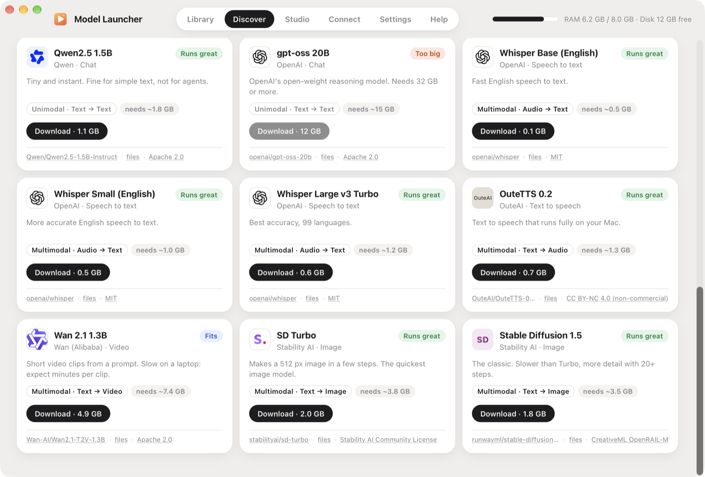

<p align="center"></p>

<h1 align="center">Model Launcher</h1>

<p align="center">Launch open-source chat, voice and image models on your Mac as easily as opening an app.<br>
Fast Rust core · memory limits you control · OpenAI-compatible API · MCP server</p>

---



Model Launcher keeps your local models in one folder, shows which ones your Mac can run well, and starts one with a click. Any app that speaks the OpenAI API or MCP (Claude, Cursor, VS Code and others) can use the models it runs.

- **Chat** with Qwen, Gemma, Llama, gpt-oss and any other `.gguf` model ([llama.cpp](https://github.com/ggml-org/llama.cpp)), including vision models that read images.
- **Voice**: speech to text with Whisper ([whisper.cpp](https://github.com/ggml-org/whisper.cpp)) and text to speech with OuteTTS (llama.cpp).
- **Images** with SD Turbo and Stable Diffusion, and **video** with Wan 2.1 ([stable-diffusion.cpp](https://github.com/leejet/stable-diffusion.cpp)).
- **Several models at once, hot-swapped.** Name any model, in the app or in an API call, and it loads. On a Mac with room, several stay loaded together; when the next one doesn't fit, the least recently used one makes way.
- **It won't run away with your memory.** You set a memory budget. Launches that don't fit are refused, a watchdog stops anything that grows past the budget, idle models unload, and you choose CPU threads, GPU use and priority.
- **One tidy folder.** Every model lives in `~/Models/{Chat,Voice,Image}/<model>/`.
- **Bring your own.** Paste any Hugging Face link, pick files already on your Mac, or drop in a folder. See [Bring your own model](docs/models.md#bring-your-own-model).
- **Clear sources.** Every card says whether a model is unimodal or multimodal, and links where it comes from and its license.

## Install

Download the latest `Model Launcher.dmg` from [Releases](https://github.com/ajokhai/model-launcher/releases), open it and drag the app to Applications. Apple Silicon, macOS 13 or later.

The first time a model needs an engine, Model Launcher installs it: llama.cpp and whisper.cpp through [Homebrew](https://brew.sh), and stable-diffusion.cpp from its official release.

**Linux (preview):** download the `.deb` (Ubuntu, Debian) or the `.AppImage` (any distro) from the same page. Engines come from the official llama.cpp, whisper.cpp and stable-diffusion.cpp releases: the Vulkan builds when your GPU supports Vulkan (NVIDIA, AMD or Intel), the CPU builds otherwise. Voice input needs `ffmpeg`, and the file picker uses `zenity` or `kdialog`. Settings, engines and logs live in `~/.local/share/Model Launcher`, and models in `~/Models` as on the Mac. The RAM budget covers system RAM; a separate GPU's video memory is managed by llama.cpp. The Linux build is new, so please [open an issue](https://github.com/ajokhai/model-launcher/issues) if something's off.

## Use it from other apps

**API** (OpenAI-compatible, on this Mac only):

```bash
curl http://127.0.0.1:11500/v1/chat/completions \
  -H "Content-Type: application/json" \
  -d '{"model": "qwen3-vl-8b", "messages": [{"role": "user", "content": "Hello!"}]}'
```

```python
from openai import OpenAI
client = OpenAI(base_url="http://127.0.0.1:11500/v1", api_key="local")
```

Endpoints: `/v1/models`, `/v1/chat/completions` (streaming too), `/v1/audio/transcriptions`, `/v1/audio/speech`, `/v1/images/generations`, and `/v1/videos/generations` (not part of OpenAI's API; same shape as images).

**MCP**: in the app, open **Connect** and press **Connect** next to Claude, Claude Code, Cursor or Windsurf. Or add it to any MCP client by hand:

```json
{ "mcpServers": { "model-launcher": { "command": "/Applications/Model Launcher.app/Contents/MacOS/model-launcher-mcp" } } }
```

Tools: `list_models`, `chat`, `transcribe`, `speak`, `generate_image`, `generate_video`, `load_model`, `unload_model`.

## Docs

- [Getting started](docs/getting-started.md)
- [Models and the ~/Models folder](docs/models.md)
- [Memory and resource limits](docs/resources.md)
- [API reference](docs/api.md)
- [MCP](docs/mcp.md)
- [Building from source](docs/development.md)

## How it's built

| Part | What it does |
|---|---|
| `crates/ml-core` | Rust. Model library, downloads, process supervisor with the memory watchdog, and the local API (axum). |
| `crates/ml-mcp` | Rust. The MCP server (stdio). Its only dependency is serde_json. |
| `app/src-tauri` | Rust + [Tauri](https://tauri.app). The native window, chat windows, MCP client setup. |
| `ui/` | The window's interface: plain HTML, CSS and JS. No build step. |

Models run in their own processes (llama.cpp, whisper.cpp, stable-diffusion.cpp), so a model can never crash the app, and quitting the app always frees their memory.

## Contributing

Issues and pull requests are welcome: new catalog models, Windows and Linux support, more engines (MLX, Kokoro TTS, FLUX) and UI polish. See [docs/development.md](docs/development.md).

## Credits and model licenses

Model Launcher stands on [llama.cpp](https://github.com/ggml-org/llama.cpp) and [whisper.cpp](https://github.com/ggml-org/whisper.cpp) (ggml.ai, MIT), [stable-diffusion.cpp](https://github.com/leejet/stable-diffusion.cpp) (leejet, MIT) and [Tauri](https://tauri.app) (MIT/Apache 2.0). Every catalog model downloads straight from [Hugging Face](https://huggingface.co) (`https://huggingface.co/<repo>/resolve/main/<file>`), and each card in the app shows the maker's logo and links its source and license. Logos are the makers' own Hugging Face avatars, shown to credit them:

| Model | Made by | Original | License |
|---|---|---|---|
| Qwen3-VL 8B / 4B, Qwen3 14B / 8B / 4B, Qwen2.5 Coder 7B, Qwen2.5 1.5B | Qwen (Alibaba) | [Qwen on Hugging Face](https://huggingface.co/Qwen) | Apache 2.0 |
| InternVL3 14B | OpenGVLab (Shanghai AI Lab) | [OpenGVLab/InternVL3-14B-Instruct](https://huggingface.co/OpenGVLab/InternVL3-14B-Instruct) (GGUF by [ggml-org](https://huggingface.co/ggml-org/InternVL3-14B-Instruct-GGUF)) | Apache 2.0 |
| Gemma 3 12B / 4B | Google | [google/gemma-3-4b-it](https://huggingface.co/google/gemma-3-4b-it) | [Gemma Terms of Use](https://ai.google.dev/gemma/terms) |
| Llama 3.2 3B | Meta | [meta-llama/Llama-3.2-3B-Instruct](https://huggingface.co/meta-llama/Llama-3.2-3B-Instruct) (GGUF by [bartowski](https://huggingface.co/bartowski/Llama-3.2-3B-Instruct-GGUF)) | [Llama 3.2 Community License](https://www.llama.com/llama3_2/license/) |
| gpt-oss 20B | OpenAI | [openai/gpt-oss-20b](https://huggingface.co/openai/gpt-oss-20b) | Apache 2.0 |
| Whisper Base / Small / Large v3 Turbo | OpenAI | [openai/whisper](https://github.com/openai/whisper) (ggml files by [ggerganov](https://huggingface.co/ggerganov/whisper.cpp)) | MIT |
| OuteTTS 0.2 | OuteAI | [OuteAI/OuteTTS-0.2-500M](https://huggingface.co/OuteAI/OuteTTS-0.2-500M), with [WavTokenizer](https://huggingface.co/novateur/WavTokenizer-large-speech-75token) (MIT) | CC BY-NC 4.0, non-commercial |
| SD Turbo | Stability AI | [stabilityai/sd-turbo](https://huggingface.co/stabilityai/sd-turbo) (GGUF by [Green-Sky](https://huggingface.co/Green-Sky/SD-Turbo-GGUF)) | [Stability AI Community License](https://stability.ai/community-license-agreement) |
| Wan 2.1 T2V 1.3B | Wan (Alibaba) | [Wan-AI/Wan2.1-T2V-1.3B](https://huggingface.co/Wan-AI/Wan2.1-T2V-1.3B) (GGUF by [samuelchristlie](https://huggingface.co/samuelchristlie/Wan2.1-T2V-1.3B-GGUF), text encoder by [city96](https://huggingface.co/city96/umt5-xxl-encoder-gguf), VAE from [Comfy-Org](https://huggingface.co/Comfy-Org/Wan_2.1_ComfyUI_repackaged)) | Apache 2.0 |
| Stable Diffusion 1.5 | Runway / Stability AI | [runwayml/stable-diffusion-v1-5](https://huggingface.co/runwayml/stable-diffusion-v1-5) (GGUF by [second-state](https://huggingface.co/second-state/stable-diffusion-v1-5-GGUF)) | CreativeML OpenRAIL-M |

Model weights aren't part of this repo and keep their own licenses. Check them before commercial use.

## License

Model Launcher's code is MIT.
